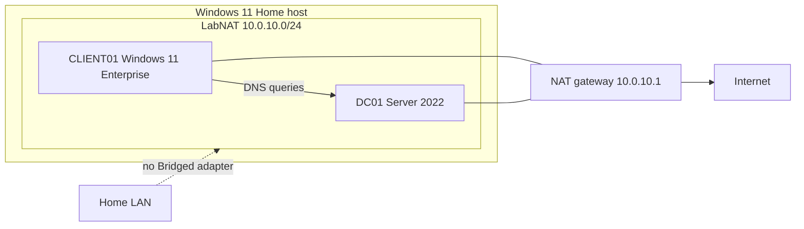

# Briccio Rapido — Windows Active Directory Home Lab

Portfolio lab for help desk, technical support, healthcare IT, and application analyst practice.

> **Status: not built.** This repository is the plan, the runbooks, and the scripts. No virtual machine has been created from it, no domain has been promoted, and `docs/screenshots/` is empty on purpose. Every checklist item below is open. I will check an item only after I have done that step and can show it.

Started October 2026. The host will be my Windows 11 Home PC (32 GB RAM) running VirtualBox 7.2. Virtual machines will be stored in `E:\VMs`.

## Overview

I am building a small Active Directory lab that stays on its own virtual network. One Windows Server 2022 Evaluation virtual machine, DC01, will be the domain controller for DNS and DHCP. One Windows 11 Enterprise Evaluation virtual machine, CLIENT01, will be the client. They will talk to each other on a VirtualBox NAT Network. They will not use a Bridged adapter, so the lab DHCP service cannot hand addresses to my home network.

The domain name in this plan is `lab.local`. That name is a choice, not a result. The scripts default to it. `corp.homelab.local` is a reasonable alternative if I decide I do not want the `.local` suffix. I have to choose before DC01 is promoted. Renaming a forest later means building it again.

Nothing here is connected to an employer, a clinic, or real user data. The people in `data/lab-users.csv` are invented.

## Why this lab

Help desk and technical support work keeps coming back to the same questions: the account is in the wrong place, the password has to change at next sign-in, the client has no address, or the client is asking the wrong DNS server. Healthcare IT and application analyst work adds a stricter habit on top of those skills: know what you changed, keep production data out of a practice environment, and write down the system you actually have.

Later phases add Group Policy, an osTicket help desk on IIS, and SQL Server Express. Those are named here so the direction is clear. They are not started.

## Skills this lab is designed to demonstrate

These are the skills the build is for. They are not claimed as finished work.

| Area | What the plan covers | Where it shows up on the job |
| --- | --- | --- |
| Virtualization | VirtualBox 7.2, an isolated NAT Network, snapshots, Guest Additions | A safe place to practice without touching the home LAN |
| Windows Server | Desktop Experience install, computer name, static IPv4 | Basic server setup a support role is expected to follow |
| Active Directory | New forest, OUs, groups, users, change password at next logon | Account work for help desk and access requests |
| DNS | AD-integrated forward and reverse zones, forwarders, clients pointed only at the DC | "The name does not resolve" tickets |
| DHCP | An authorized scope and the router, DNS, and domain options | "The PC has a 169.254 address" tickets |
| PowerShell | Parameters, comment-based help, `-WhatIf`, reruns that skip existing objects, no stored passwords | Work I can explain and repeat |
| Later | Group Policy, osTicket on IIS, SQL Server Express | A ticket queue and a database an application analyst can inspect |

Windows 11 Home, the host, cannot join an Active Directory domain. CLIENT01 is Windows 11 Enterprise Evaluation because that edition can.

## Lab topology



DC01 is `10.0.10.10`. CLIENT01 is planned to take a DHCP address from `10.0.10.100` through `10.0.10.200`. The gateway `10.0.10.1` is the VirtualBox NAT engine, not a virtual machine. Internet access is outbound only, for Windows Update and evaluation activation. The home LAN is not attached.

> TODO: add screenshot
>
> `docs/screenshots/topology-nat-network.png`
>
> Network Manager showing LabNAT at `10.0.10.0/24`, with DHCP off, after the steady state is reached. No adapter in this lab uses Bridged mode.

## Virtual machine specifications

| VM | Operating system | vCPU | RAM | Disk | Network |
| --- | --- | --- | --- | --- | --- |
| DC01 | Windows Server 2022 Evaluation, Desktop Experience | 2 | 4 GB | 60 GB dynamic VDI | NAT Network `LabNAT` only |
| CLIENT01 | Windows 11 Enterprise Evaluation | 2 | 4 GB | 64 GB dynamic VDI | NAT Network `LabNAT` only |

Both disks are planned as dynamically allocated VDI files under `E:\VMs`. Dynamic disks start small and grow as the guest writes data. Snapshots add more files on `E:` over time.

CLIENT01 at 4 GB meets the Windows 11 minimum and will be tight once applications are installed. I am keeping the published spec at 4 GB unless a later phase has a reason to change it. The host has 32 GB, and the two guests together are planned for 8 GB, which leaves room for Windows 11 Home.

DC01 does not need a virtual TPM. CLIENT01 does: EFI, TPM 2.0, and Secure Boot, set before the first boot. Details are in [docs/01-virtualbox-setup.md](docs/01-virtualbox-setup.md).

## Naming, domain, and IP plan

| Item | Value |
| --- | --- |
| NAT Network name | `LabNAT` |
| IPv4 network | `10.0.10.0/24` |
| Subnet mask | `255.255.255.0` |
| NAT gateway | `10.0.10.1` (confirm in Network Manager; this is the VirtualBox default for this prefix) |
| DC01 address | `10.0.10.10` static |
| DC01 DNS | `10.0.10.10` only |
| Reserved for static servers | `10.0.10.11`–`10.0.10.99` |
| DHCP scope | `10.0.10.100`–`10.0.10.200` |
| Left unused | `10.0.10.201`–`10.0.10.254` |
| DHCP router option | `10.0.10.1` |
| DHCP DNS option | `10.0.10.10` |
| DHCP DNS domain option | `lab.local` |
| Lease | 8 days |
| DNS name | `lab.local` |
| NetBIOS name | `LAB` |
| Functional level | Windows Server 2016 (the highest level Server 2022 offers) |
| DNS forwarders | `1.1.1.1` and `8.8.8.8`, set on the DNS server, not on the adapters |

Public DNS servers stay off the adapter on both VMs. If a public resolver is listed beside the domain controller, Windows will use it when the domain controller is slow, and domain lookups will fail. Internet names go through the forwarders after AD DNS is installed.

VirtualBox can run its own DHCP server on a NAT Network. That server will be on only while the operating systems are being installed, then turned off before Windows DHCP is authorized. The steady state is one DHCP server: DC01.

`.local` can collide with mDNS on a network that has other `.local` devices. This lab network is isolated and has no other mDNS services planned, so `lab.local` is acceptable. I will not attach it to the home LAN.

## OU and user plan

```text
lab.local
└── Company
    ├── IT
    │   ├── Users
    │   ├── Computers
    │   └── Groups
    ├── HR
    │   ├── Users
    │   ├── Computers
    │   └── Groups
    ├── Lab Operations
    │   ├── Users
    │   ├── Computers
    │   └── Groups
    └── Finance
        ├── Users
        ├── Computers
        └── Groups
```

Each department gets a global security group in its Groups OU. The group name matches the department. The `sAMAccountName` drops spaces, so the Lab Operations group is `LabOperations`.

`data/lab-users.csv` has 12 fictional people, three in each department. They are not real, and they are not based on coworkers or patients. `scripts/05-New-LabUsers.ps1` asks for one initial password at runtime and sets "user must change password at next logon" on each new account. That password is not stored in this repository. Using one bootstrap password for a lab import is not how passwords should be issued in production. The change-at-logon flag is what makes the bootstrap temporary.

The built-in Users and Computers containers are not where these objects go. New domain computers still land in the built-in Computers container until that default is changed. That move is a later client-join step, and it is not done.

> TODO: add screenshot
>
> `docs/screenshots/ou-tree.png`
>
> Active Directory Users and Computers showing the Company OU and the four departments after they exist.

> TODO: add screenshot
>
> `docs/screenshots/lab-users.png`
>
> The fictional users in their department Users OUs. The image must not show a password.

## Repository layout

```text
.
├── README.md
├── LICENSE
├── .gitignore
├── data/
│   └── lab-users.csv
├── docs/
│   ├── 01-virtualbox-setup.md
│   ├── 02-domain-controller.md
│   └── screenshots/
│       └── .gitkeep
└── scripts/
    ├── 01-Set-ServerBasics.ps1
    ├── 02-Install-ADDSForest.ps1
    ├── 03-Configure-DHCP.ps1
    ├── 04-New-LabOUs.ps1
    └── 05-New-LabUsers.ps1
```

| File | Purpose |
| --- | --- |
| [docs/01-virtualbox-setup.md](docs/01-virtualbox-setup.md) | NAT Network, both VMs, Windows 11 TPM and Secure Boot, Guest Additions, snapshots |
| [docs/02-domain-controller.md](docs/02-domain-controller.md) | Server 2022 Desktop Experience, DC01, static IP, new forest, DNS, DHCP, troubleshooting |
| `scripts/01-Set-ServerBasics.ps1` | Rename the server and set the static IPv4 address and DNS |
| `scripts/02-Install-ADDSForest.ps1` | Install AD DS and promote a new forest; DSRM password is typed, never stored |
| `scripts/03-Configure-DHCP.ps1` | Authorize DHCP and create the lab scope |
| `scripts/04-New-LabOUs.ps1` | Create the OU tree and department groups |
| `scripts/05-New-LabUsers.ps1` | Create users from the CSV and add them to department groups |

The scripts target Windows PowerShell 5.1 on the server, run elevated, from the VirtualBox console. They have not been executed against a domain controller. `-WhatIf` is there so the first real run can be a dry run. Reruns skip objects that already exist. They do not delete OUs, reset an existing user's password, or resize an existing DHCP scope.

ISOs, virtual disks, and `.vbox` files are gitignored. They belong in `E:\VMs` or with the installation media, not in git.

## Phases

### Phase 1 — VirtualBox and base VMs

Not started. [docs/01-virtualbox-setup.md](docs/01-virtualbox-setup.md) is the runbook: install VirtualBox 7.2, store machines in `E:\VMs`, create `LabNAT`, create both VMs, install the operating systems, install Guest Additions, and take a powered-off baseline snapshot.

### Phase 2 — Domain controller

Not started. [docs/02-domain-controller.md](docs/02-domain-controller.md) is the runbook: Desktop Experience, rename, static IP, new forest, DNS checks, DHCP scope, OUs, and the fictional users.

### Phase 3 — Domain client

Not started. There is no client runbook yet. The intended work is: CLIENT01 gets its address and DNS from DC01, joins `lab.local`, moves out of the built-in Computers container, and a fictional user signs in and changes the bootstrap password. I will write that up when I do it.

### Phase 4 — Group Policy

Not started. The intended work is a written design first, then a password and lockout policy, then one department-targeted setting, then `gpresult` from CLIENT01. No policies exist.

### Phase 5 — osTicket on IIS

Not started. osTicket is the planned help-desk queue. The lab currently has two VMs. Putting IIS on a domain controller is a small-lab shortcut and a bad production habit. When this phase starts, I will either add a member server or write down why the service is on DC01 and what I would separate in a real change. No IIS site has been created.

### Phase 6 — SQL Server Express

Not started. The intended work is a lab database with no real data, a backup, and a note about who can sign in. osTicket may use that instance. SQL Server Express is not installed.

## Progress checklist

Checked items would mean I did the work and can point at a screenshot or a command result. None are checked.

### Phase 1

- [ ] Install VirtualBox 7.2.2 or a later 7.2 update on the Windows 11 Home host
- [ ] Set the default machine folder to `E:\VMs`
- [ ] Download the Windows Server 2022 Evaluation ISO and the Windows 11 Enterprise Evaluation ISO from Microsoft
- [ ] Create NAT Network `LabNAT` at `10.0.10.0/24`
- [ ] Confirm the NAT gateway address, expected to be `10.0.10.1`
- [ ] Confirm no virtual machine adapter is attached to a Bridged adapter
- [ ] Create DC01 with 2 vCPU, 4 GB RAM, and a 60 GB dynamic disk
- [ ] Create CLIENT01 with 2 vCPU, 4 GB RAM, and a 64 GB dynamic disk
- [ ] Enable EFI, TPM 2.0, and Secure Boot on CLIENT01 before first boot
- [ ] Install Windows Server 2022 Standard Evaluation (Desktop Experience) on DC01
- [ ] Install Windows 11 Enterprise Evaluation on CLIENT01 and name it CLIENT01
- [ ] Install Guest Additions on DC01
- [ ] Install Guest Additions on CLIENT01
- [ ] Take a powered-off baseline snapshot of each VM
- [ ] Add the Phase 1 screenshots under `docs/screenshots/`

### Phase 2

- [ ] Copy or clone this repository onto DC01 while that guest still has internet
- [ ] Turn off the VirtualBox DHCP server on `LabNAT`
- [ ] Rename the server to DC01
- [ ] Set DC01 to `10.0.10.10/24`, gateway `10.0.10.1`, DNS `10.0.10.10`
- [ ] Reboot and confirm the active computer name and the static address
- [ ] Promote DC01 to a new forest named `lab.local`
- [ ] Sign in as `LAB\Administrator` after promotion
- [ ] Confirm SYSVOL and NETLOGON are shared
- [ ] Set DNS forwarders to `1.1.1.1` and `8.8.8.8`
- [ ] Create the `10.0.10.0/24` reverse lookup zone
- [ ] Run the DNS checks in `docs/02-domain-controller.md` and record what they returned
- [ ] Install and authorize DHCP
- [ ] Create the scope `10.0.10.100`–`10.0.10.200` with the gateway, DNS, and domain options
- [ ] Create the Company OU tree and the department groups
- [ ] Create the fictional users from `data/lab-users.csv`
- [ ] Run scripts 04 and 05 a second time and confirm they do not recreate existing objects
- [ ] Take a snapshot of DC01 after the directory work
- [ ] Add the Phase 2 screenshots under `docs/screenshots/`

### Phase 3

- [ ] Give CLIENT01 an address from the lab DHCP scope, with DNS `10.0.10.10` only
- [ ] Join CLIENT01 to `lab.local`
- [ ] Move CLIENT01 out of the built-in Computers container into a department Computers OU
- [ ] Sign in as a fictional lab user and change the password when prompted
- [ ] Write the client-join notes and add screenshots

### Phase 4

- [ ] Write the Group Policy design before linking anything
- [ ] Create a password and lockout policy for the lab
- [ ] Link one setting to a single department OU
- [ ] Run `gpresult` on CLIENT01 and save the relevant output
- [ ] Document what was linked and why

### Phase 5

- [ ] Decide whether IIS and osTicket live on DC01 or on a new member server, and write down the reason
- [ ] Install IIS
- [ ] Install osTicket and complete one practice ticket from open to close
- [ ] Document how the ticket data will be backed up
- [ ] Add screenshots of the ticket, with no real personal data

### Phase 6

- [ ] Install SQL Server Express in the place decided in Phase 5
- [ ] Create a lab database that contains no real data
- [ ] Connect osTicket or a separate sample to that instance, and record which one
- [ ] Take a backup and record the instance name and who can sign in
- [ ] Add screenshots that do not show a password or a connection string with a secret

## Screenshots

The image files do not exist yet. When a phase is done, the image goes in `docs/screenshots/` and the matching note in the docs changes from "TODO: add screenshot" to a one-line description of what the image shows. Passwords, product keys, and recovery keys stay out of the frame.

| Planned file | What it should show, once the step exists |
| --- | --- |
| `docs/screenshots/vbox-version.png` | VirtualBox 7.2.x About dialog on the Windows 11 Home host |
| `docs/screenshots/machine-folder.png` | Default machine folder set to `E:\VMs` |
| `docs/screenshots/nat-network.png` | `LabNAT`, prefix `10.0.10.0/24`, DHCP disabled |
| `docs/screenshots/dc01-network.png` | DC01 adapter attached to NAT Network `LabNAT`, not Bridged |
| `docs/screenshots/client01-firmware.png` | CLIENT01 with EFI, TPM 2.0, and Secure Boot enabled |
| `docs/screenshots/guest-additions.png` | Guest Additions installed in one guest |
| `docs/screenshots/snapshots-baseline.png` | Powered-off baseline snapshot for each VM |
| `docs/screenshots/server-edition.png` | Server 2022 Standard Evaluation (Desktop Experience) selected |
| `docs/screenshots/dc01-ipconfig.png` | DC01 at `10.0.10.10/24` with DNS `10.0.10.10` |
| `docs/screenshots/promotion.png` | Domain controller promotion completed for `lab.local` |
| `docs/screenshots/dns-zones.png` | Forward lookup zone and the `10.0.10.0/24` reverse zone |
| `docs/screenshots/dhcp-scope.png` | Authorized scope `10.0.10.100`–`10.0.10.200` |
| `docs/screenshots/ou-tree.png` | Company OU and the four departments |
| `docs/screenshots/lab-users.png` | Fictional users in a department Users OU |

## Safety and scope

- The lab network is a VirtualBox NAT Network. Bridged mode is out of scope for every adapter in this lab.
- Windows DHCP is not authorized until the VirtualBox DHCP server on `LabNAT` is off.
- Evaluation media comes from Microsoft. I will not put a product key in this repository.
- Passwords are typed when a script asks for them. They are not parameters, and they are not written into the CSV.
- No patient, customer, student, or coworker data belongs in this lab.
- Windows Firewall stays on. The server roles add the rules they need.
- This is evaluation software for practice, not a production directory.

## License

[MIT](LICENSE). Copyright (c) 2026 Briccio Rapido.
